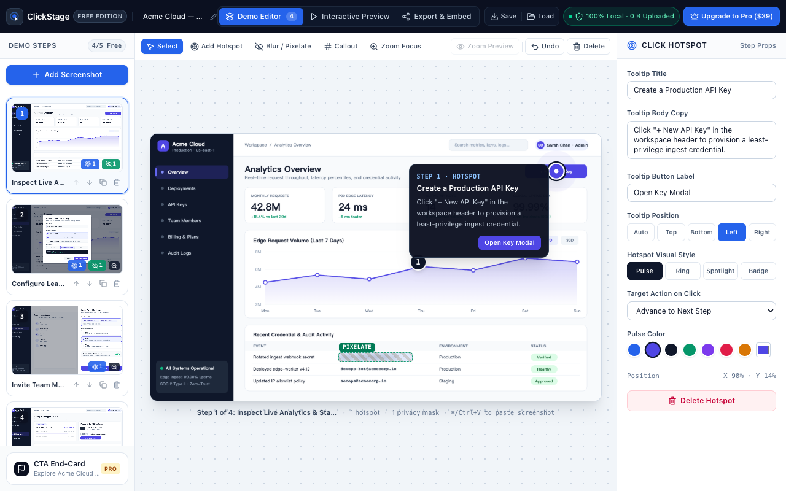
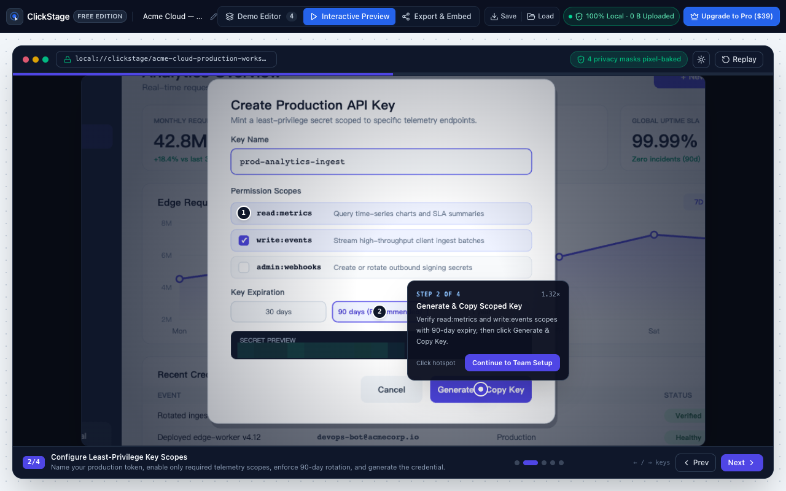
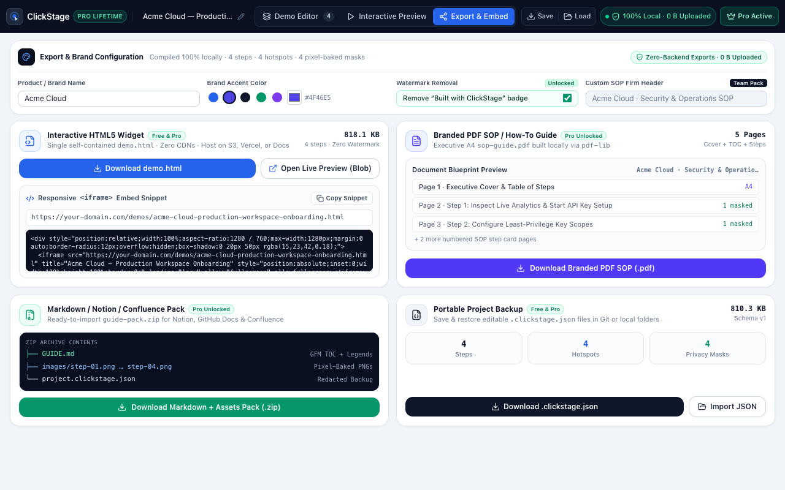
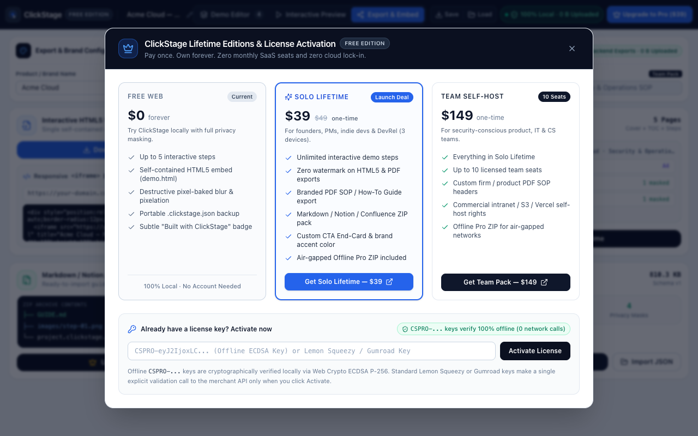

<div align="center">

# ClickStage

### Local-First Interactive Product Demo & SOP Guide Studio

**Turn product screenshots into self-contained clickable HTML5 embeds, branded PDF SOP guides, and Notion/Markdown documentation packs — 100% locally in your browser. Zero cloud uploads. Pay once.**

[](https://aurelius-aka.github.io/clickstage/)
[](https://aurelius-aka.github.io/clickstage/)
[](#pro-lifetime--air-gapped-offline-edition)

**[Try Live Studio Instantly (No Signup Required) → `https://aurelius-aka.github.io/clickstage/`](https://aurelius-aka.github.io/clickstage/)**

*Test the full editor, live clickable player, and standalone HTML5 export in 10 seconds using the built-in **Load Interactive SaaS Demo (4 Steps)** sample project.*

</div>

---

## Why Teams Switch From $50/mo Cloud Demo SaaS

Interactive product tours and step-by-step SOPs are some of the highest-converting assets on any landing page or help center — yet existing tools force an uncomfortable trade-off:

- **Expensive per-seat recurring subscriptions** — Supademo ($38–$50/creator/mo), Arcade ($42.50–$50/seat/mo), Storylane ($40–$50/mo Starter, $500/mo Growth), and Scribe ($25–$35/mo) charge **$300–$600/year** forever and break your embeds if you cancel.
- **Cloud-upload privacy risk & risky browser extensions** — Uploading internal dashboards, customer billing screens, or pre-release UI to a third-party SaaS (or installing a Chrome extension with *"Read and change all your data on all websites"* permissions) is a non-starter for security-conscious teams.
- **Reversible CSS blur traps** — Many browser demo tools hide sensitive emails or API keys using CSS `filter: blur()` overlays, leaving the raw unblurred screenshot sitting intact in the DOM/network payload.

**ClickStage runs 100% client-side in your browser RAM** — combining an interactive demo studio, destructive Canvas pixel-baked redaction, zero-CDN standalone `demo.html` export, client-side `pdf-lib` SOP generation, and Markdown ZIP packaging in one fast local workspace.

---

## Product Tour

### 1. Demo Editor — Hotspots, Spotlight Zoom, Callout Pins & True Pixel-Baked Masks
Drop screenshots or paste straight from your clipboard (`Cmd/Ctrl+V`), place pulsing click hotspots with auto-positioned tooltips, configure spotlight zoom keyframes (`1.0x–3.0x`), add numbered callout pins, and draw **Quantized Pixelate**, **3-Pass Box Blur**, or **Solid Redaction** masks over sensitive emails, API secrets, or billing data.



### 2. Interactive Preview — Smooth Zoom, Keyboard Nav & Customizable CTA End-Card
Click through your guided product tour exactly as visitors will experience it: pulsing hotspot indicators, smooth zoom-into-hotspot transitions, spotlight vignettes, step-switcher drawer, full keyboard navigation (`←`/`→`, `1–9`, `R`), Light/Dark chrome, and a conversion-ready **CTA End-Card**.



### 3. Export & Embed Studio — 3 Production Deliverables From 1 Project
Generate every format locally in one click — **zero servers, zero queues, zero external CDNs**:
- **Self-Contained Interactive HTML5 (`demo.html`)** + responsive `<iframe>` embed snippet (drop onto Vercel, Netlify, GitHub Pages, S3, Webflow, Framer, or internal docs).
- **Branded PDF SOP / How-To Guide (`sop-guide.pdf`)** built client-side via `pdf-lib` with cover page, Table of Steps, and annotated A4 step cards.
- **Markdown + Assets Pack (`guide-pack.zip`)** containing `GUIDE.md`, pixel-baked `images/step-01.png`…`step-NN.png`, and portable `project.clickstage.json` for Notion, Confluence, Linear, or GitHub.



### 4. Local-First Privacy Architecture & Offline ECDSA Licensing
Verify zero-upload behavior in real time via the built-in Privacy Drawer, or unlock Pro completely offline using cryptographically signed `CSPRO-...` **ECDSA P-256 (`ES256`)** keys — plus a pre-unlocked **Air-Gapped Offline Pro ZIP** (`clickstage-pro-offline.zip`) for Mac, Windows, and Linux.



---

## Zero-Upload Architecture Proof

You don't have to take privacy on faith — verify it yourself in 10 seconds:

1. Open **[`https://aurelius-aka.github.io/clickstage/`](https://aurelius-aka.github.io/clickstage/)** in your browser.
2. Open **DevTools → Network** tab (or turn on **Airplane Mode** after the page loads).
3. Load the 4-step demo (or drop your own screenshots), draw blur/pixelate masks, preview interactively, and export `demo.html`, `sop-guide.pdf`, and `guide-pack.zip`.
4. Observe **`0 bytes uploaded`** and **zero outbound network requests** across every authoring and export operation.

### How the Local-First Destructive Export Pipeline Works
```text
Screenshots & Clipboard Pastes (Browser RAM Only — 0 B Uploaded)
  ├─► 1. Destructive Canvas Pixel Baking (Offscreen Canvas ImageData)
  │      └─ Irreversibly overwrites masked regions with Quantized Pixelation,
  │         3-Pass Separable Box Blur, or Solid Redaction directly in pixel bytes
  │         (no reversible CSS blur overlays; outside pixels remain bit-for-bit sharp)
  ├─► 2. Zero-CDN Standalone HTML5 Compiler (demo.html)
  │      └─ Inlines baked PNGs, player engine, CSS, keyboard nav, zoom & CTA End-Card
  │         into a single self-contained file — 0 external <script>, <link>, or trackers
  ├─► 3. Client-Side PDF SOP Generator (pdf-lib)
  │      └─ Builds cover page, Table of Steps & annotated A4 step cards in browser RAM
  └─► 4. Portable Markdown + Assets Packager (JSZip)
         └─ Bundles GFM GUIDE.md + pixel-baked images/step-XX.png + project.clickstage.json
```

- **Zero External Scripts or CDNs in Exports:** Every exported `demo.html` passes strict CSP rules, loads instantly offline, and emits clean `window.parent.postMessage({ type: 'clickstage:step', index, total })` events if you want to wire your own privacy-friendly analytics.
- **Zero Chrome Extension Permissions:** Drop screenshots or press `Cmd/Ctrl+V` — no extension ever touches your browser sessions or internal admin panels.
- **Offline Cryptographic Licensing:** `CSPRO-...` keys validate purely locally via Web Crypto **ECDSA P-256** with zero internet connection required, and every Pro tier includes the pre-unlocked standalone **Offline Pro ZIP**.

---

## Verified 2026 Competitor Pricing Comparison

| Tool | Verified 2026 Pricing | Annual Cost (1 Creator) | Privacy & Architecture | Self-Contained HTML5 Embed | Branded PDF & Markdown SOPs |
| :--- | :--- | :---: | :--- | :---: | :---: |
| **Supademo** | $38–$50/creator/mo | $456–$600/yr | Cloud SaaS (hosts screenshots) | Hosted iframe | Cloud / paid tier |
| **Arcade** | $42.50–$50/seat/mo | $510–$600/yr | Cloud SaaS (seat subscription) | Hosted iframe | Limited |
| **Storylane** | $40–$50/mo Starter · $500/mo Growth | $480–$6,000/yr | Cloud SaaS | Hosted iframe | No standalone SOP pack |
| **Scribe** | $25–$35/mo solo | $300–$420/yr | Cloud SaaS + Chrome extension | No clickable demo player | Cloud SOP export |
| **Folge** | $89 Personal · $155 Business (one-time) | $89–$155 once | Local desktop app | Static docs only (no interactive player) | Yes |
| **ClickStage** | **Free Tier** / **$39 Launch · $49 Solo · $149 Team (One-Time)** | **$39 once** | **100% Browser-Local + Air-Gapped Offline ZIP** | **Zero-CDN `demo.html` (own forever)** | **Yes (`sop-guide.pdf` + `guide-pack.zip`)** |

*ClickStage Solo Lifetime pays for itself in less than **one month** of Supademo, Arcade, or Storylane — and delivers both clickable HTML5 demos and static SOP guides in one local tool.*

---

## Pro Lifetime & Air-Gapped Offline Edition

### Tier Comparison

| Feature | **Free Web Edition ($0)** | **Solo Lifetime Pro ($39 Launch / $49 Regular)** | **Team Self-Host Pack ($149 One-Time)** |
| :--- | :---: | :---: | :---: |
| **Interactive Editor, Hotspots, Callouts & Spotlight Zoom** | Included | Included | Included |
| **True Pixel-Baked Blur, Pixelate & Solid Redaction** | Included | Included | Included |
| **Max Steps per Exported Demo / SOP** | Up to 5 steps | **Unlimited** | **Unlimited** |
| **Standalone Interactive HTML5 (`demo.html`) + `<iframe>` Snippet** | Included (subtle badge) | **Zero Watermarks** | **Zero Watermarks** |
| **Interactive CTA End-Card (Headline, Button URL, Replay)** | Editor preview | **Full Export** | **Full Export** |
| **Custom Brand Accent Color** | Default Indigo | **Any Hex Brand Color** | **Any Hex Brand Color** |
| **Branded PDF SOP / How-To Guide (`sop-guide.pdf`)** | Preview banner | **Full Unwatermarked Export** | **Full + Custom Brand Header** |
| **Markdown + Assets Pack (`guide-pack.zip` for Notion/Confluence/GitHub)** | Preview | **Full Export** | **Full Export** |
| **Portable Project Save & Load (`.clickstage.json`)** | Included | Included | Included |
| **Air-Gapped Offline Pro ZIP (`clickstage-pro-offline.zip`)** | — | **Included Forever (3 devices)** | **Included Forever (10 seats + Intranet/S3/Vercel self-host rights)** |

### Request Pro Lifetime Access / Early-Bird Launch Tier ($39)

Our self-serve Lemon Squeezy & Gumroad checkout storefronts are currently being finalized. While direct checkout is being connected, you can lock in the **$39 Launch Early-Bird Solo Lifetime** tier, request a **$149 Team 10-Seat / Intranet Self-Host** invoice, or request an offline ECDSA evaluation key directly via GitHub:

- **[Request Solo Lifetime ($39 Launch) or Team Pack ($149) via GitHub Issues](https://github.com/Aurelius-aka/clickstage/issues/new?title=%5BPro%20Access%5D%20ClickStage%20Pro%20Lifetime%20%2F%20Offline%20Edition%20Inquiry&body=Tier%20of%20interest%20(Solo%20%2439%20Launch%20%2F%20Team%20%24149%2010-Seat)%3A%0AUse%20case%20(SaaS%20Demos%20%2F%20Onboarding%20%2F%20Internal%20SOPs%20%2F%20Docs)%3A%0ANeed%20air-gapped%20offline%20ECDSA%20key%20%2B%20ZIP%3F%20(Yes%2FNo)%3A)**
- **[Report a Bug or Request an Export Feature](https://github.com/Aurelius-aka/clickstage/issues/new)**

---

## More Local-First, Zero-Upload Tools

- **[NullMark](https://aurelius-aka.github.io/nullmark/)** ([GitHub](https://github.com/Aurelius-aka/nullmark)) — Zero-upload true PDF pixel-burn redactor, forensic PDF leak auditor (`Verify Any PDF`), SHA-256 compliance certificates, and reversible ChatGPT/Claude AI Privacy Shield. Runs 100% locally in your browser with `0 bytes uploaded`.

---

## License & Notice

This public repository hosts the product showcase and the compiled static web demo deployed via GitHub Pages (`gh-pages`). The ClickStage application, proprietary source code, and standalone Offline Pro distribution are **All Rights Reserved**. See [`LICENSE`](LICENSE) for details.
